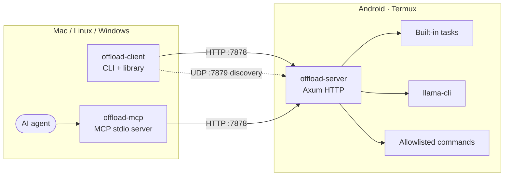

<div align="center">

# AndroidOffload

**Turn your Android phone into a tiny compute node.**
Offload ML inference and compute jobs from your laptop to **Termux** — over your LAN, with one static binary.

[](LICENSE)


</div>

---

## Features

| | |
|---|---|
| **Zero-config discovery** | UDP broadcast + multicast on port `7879` — no phone IP to look up |
| **llama.cpp inference** | Run GGUF models from `--models-dir` (path-traversal protected) |
| **Built-in tasks** | `echo`, `mat_mul`, `cosine_top_k` on `spawn_blocking` |
| **Allowlisted commands** | Run `python3`, `whisper-cli`, etc. — only what you permit via `--allow-cmd` |
| **Resumable uploads** | Push multi-GB models with BLAKE3 integrity checks, resume, and a speed/ETA bar |
| **Sync & async jobs** | `/v1/run` for quick calls, `/v1/jobs` for long-running work |
| **Bearer-token auth** | Plus `--max-concurrent` to keep your phone from melting |
| **Agent-ready** | Ships an MCP stdio server and a workspace skill |

## Architecture



| Crate | Role |
|---|---|
| [`offload-protocol`](crates/protocol/src/lib.rs) | Shared JSON/HTTP wire types (`TaskKind`, `TaskResult`, `JobRecord`, `NodeInfo`) |
| [`offload-server`](crates/server/src/main.rs) | Async Axum server that runs inside Termux |
| [`offload-client`](crates/client/src/main.rs) | Rust client library + CLI for your host |
| [`offload-mcp`](crates/mcp/src/main.rs) | MCP stdio server exposing the node as agent tools |

## Quick start

### 1. Cross-compile the server

```bash
rustup target add aarch64-unknown-linux-musl
cargo build --release -p offload-server --target aarch64-unknown-linux-musl
```

Produces a ~5.5 MB static `aarch64` binary at `target/aarch64-unknown-linux-musl/release/offload-server`.

<details>
<summary>Build notes</summary>

- Linking uses `rust-lld` (see [`.cargo/config.toml`](.cargo/config.toml)).
- The build targets `cortex-a76` (any flagship phone since 2019); remove `target-cpu` for older devices.
- With an aarch64 musl C toolchain (`brew install filosottile/musl-cross/musl-cross`), add `--features mimalloc` for a faster allocator.

</details>

### 2. Copy it to Termux over LAN (no ADB, no Rust on the phone)

On your computer:

```bash
python3 -m http.server 8000 --directory target/aarch64-unknown-linux-musl/release
```

In Termux:

```bash
curl -O http://<host-lan-ip>:8000/offload-server
chmod +x offload-server
./offload-server \
  --bind 0.0.0.0:7878 \
  --token "your-secret-token" \
  --max-concurrent 1 \
  --models-dir ~/models \
  --allow-cmd python3,whisper-cli
```

> Run `termux-wake-lock` before long jobs so Android doesn't throttle or sleep the process.

### 3. Use it from your host

```bash
export OFFLOAD_TOKEN="your-secret-token"

cargo run -p offload-client -- discover          # list nodes on the LAN
cargo run -p offload-client -- info              # auto-discovers the first node
```

Pass `--url http://<phone-ip>:7878` (or set `OFFLOAD_URL`) to skip discovery.

**Push a model** (resumes automatically, shows speed + ETA):

```bash
cargo run -p offload-client -- push ./qwen2.5-3b-instruct-q4_k_m.gguf
```

**Benchmarks:**

```bash
cargo run -p offload-client -- echo "hello from my laptop"
cargo run -p offload-client -- matmul-bench --size 512
```

**LLM inference** (sync, or `--async` for a job):

```bash
cargo run -p offload-client -- llama \
  --model qwen2.5-3b-instruct-q4_k_m.gguf \
  --prompt "Summarize why on-device offload is useful." \
  --max-tokens 256 \
  --async
```

**Allowlisted scripts:**

```bash
cargo run -p offload-client -- cmd --program python3 -- ~/scripts/run_onnx.py --input data.json
```

## Use with AI agents (MCP)

```bash
cargo build --release -p offload-mcp
```

Add to your agent's MCP config:

```json
{
  "mcpServers": {
    "android-offload": {
      "command": "/absolute/path/to/target/release/offload-mcp",
      "env": {
        "OFFLOAD_TOKEN": "your-secret-token"
      }
    }
  }
}
```

Exposes `discover_nodes`, `node_info`, `run_llama`, `run_command`, `run_task`, and `get_job` as agent tools. A workspace skill lives at [`.agents/skills/android-offload/SKILL.md`](.agents/skills/android-offload/SKILL.md).

## Security

- Set `--token` whenever the server is reachable by anyone but you; it is plain HTTP, so keep it on a trusted LAN or tunnel it.
- Commands are deny-by-default: only programs in `--allow-cmd` can run.
- Model paths are confined to `--models-dir`.

## License

[GPL-3.0-or-later](LICENSE)
